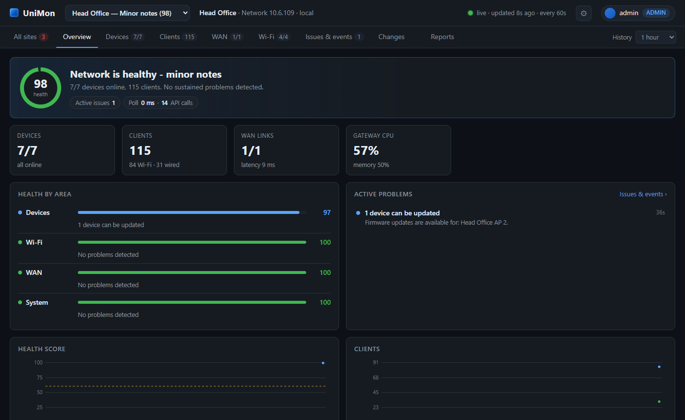
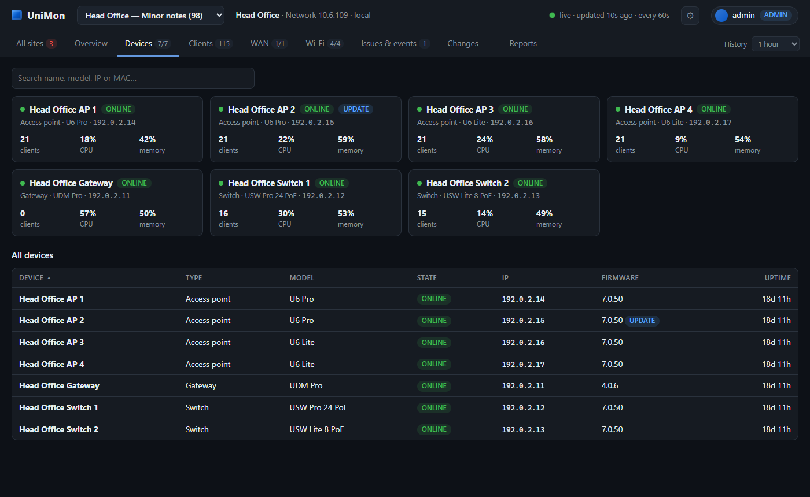

# UniMon

**Monitoring for Ubiquiti UniFi that shows site health and what needs attention.** UniMon reads your UniFi consoles
(gateways and Cloud Keys running the Network application) through their read-only API keys, and optionally the UniFi
Site Manager, and serves a live dashboard on a server you run yourself. No agents, no cloud service of ours, and free to use.

UniMon is part of [MonStack](https://github.com/RowShack/MonStack), a family of monitoring apps that share one look, one sign-in model and the
same signed updates.

## What it does

- **Overview, Devices, Clients, WAN and Wi-Fi** for every console's sites, with a drill-down panel per device, client and
  issue.
- **Problems with a cause.** Health checks turn readings into issues with a severity, shown on **Issues & events**.
- **Changes.** UniFi has no change log, so UniMon compares each reading of a console with the one before: devices added,
  removed or renamed, new firmware or address, the console's version and a WAN's public address.
- **WAN health.** Official ISP, latency and loss data when a Site Manager key is added. The gateway's WAN health in the local
  API is Ubiquiti's unofficial `stat/health` and is labelled that way.
- **Reports, alerts and a wallboard.** Weekly and monthly reports by email, alerts to Teams, webhooks and email, and a
  full-screen wallboard.
- **Users with roles**, two-step sign-in, backup and restore, signed in-app updates.
- **Demo mode** with three simulated consoles, so you can look around without UniFi gear.
- **SiteMon.** UniMon serves a summary card that [SiteMon](https://github.com/RowShack/SiteMon) can show on one wallboard
  with your other MonStack apps.

Not verified on real gear yet: a console that holds several sites, and the larger UniFi setups. The demo covers them only
with simulated data.

## Quick install

Download the files from the [latest release](https://github.com/RowShack/UniMon/releases/latest).

- **Windows:** double-click `UniMon-<version>.msi` and answer the questions (run as a service, who may connect, port).
- **Linux:** `sudo sh unimon-<version>-linux.run` (systemd and Python 3.9 or newer).

Open `https://<server>:7443/`, create the first admin account, then add a console under **Settings > Consoles**. The
[setup guide](docs/setup.md) covers the details.

## Documentation

- [Setup guide](docs/setup.md): install, make the API key on the console, add it.
- [Configuration reference](docs/configuration.md): every Settings section, the data folder and the command line.
- [FAQ](docs/faq.md): common problems and questions.
- [Running it safely](docs/security.md): VPN or tailnet first, `trusted_proxies`, two-step sign-in, what was checked.

## Help and feedback

- **Questions, bugs and ideas:** [open an issue](https://github.com/RowShack/UniMon/issues/new/choose). Please give the version and
  your operating system, and never paste API keys, passwords, configuration files or customer data.
- **Security problems:** please do not use public issues. See [SECURITY.md](SECURITY.md) to report them privately.
- The other apps and the overall picture: [MonStack](https://github.com/RowShack/MonStack).

## Licence

UniMon is free to use and closed source. Read the [licence](LICENSE): you may install and use it, but not copy, sell, modify
or reverse engineer it.

Ubiquiti, UniFi and UniFi Network are trademarks of their owners. UniMon is an independent product and is not affiliated
with or endorsed by them.
